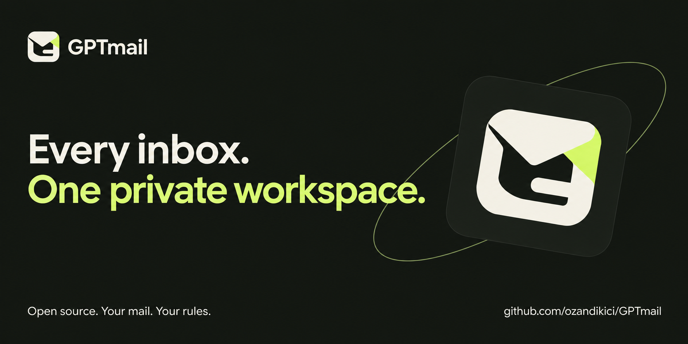

# GPTmail

**Every inbox. One private workspace.**

An open-source workspace for your compatible mail accounts, with a password-protected dashboard and an OAuth-protected MCP connection for ChatGPT. Deploy your own instance, connect your inboxes, and decide what your AI assistant can do.

GPTmail brings multiple accounts into one browser workspace. Search and read a selected mailbox, then selectively enable sending, replying, forwarding, flagging, moving and trashing messages. **Each MCP capability is controlled from the dashboard.** Outgoing mail and Trash actions can require a second approval in the dashboard; both approval switches are **ON** by default.

- **Free-tier-friendly:** FastAPI on Vercel + a persistent Upstash Redis database (check each service's current terms and quotas).
- **Multiple providers:** Standard IMAP/SMTP accounts, plus Gmail and Microsoft OAuth after you configure your own provider app registrations.
- **Encrypted credentials:** IMAP/SMTP account records and pending outbound drafts encrypted with Fernet before storage.
- **Remote MCP:** Streamable HTTP at `/mcp`, compatible with MCP 2025 and the 2026-07-28 stateless revision.
- **OAuth:** Authorization Code + PKCE (S256), Dynamic Client Registration, scoped owner consent, bearer tokens and rotating refresh tokens.
- **Single-owner:** A password-protected private admin dashboard. Your public **source code** does not make your deployed mailbox public.
- **MIT licensed.** Python, HTML, CSS and vanilla JavaScript; no OpenAI API key required.

> **Private by design, with a clear data boundary:** Mail credentials and provider tokens stay in encrypted server-side storage. **Email content you ask ChatGPT to read is sent to ChatGPT.** Email content is untrusted third-party data, not instructions. Sending is initially disabled. GPTmail is an early single-owner project; it has not undergone an independent security audit.

[Türkçe kurulum](docs/README.tr.md) · [Mail provider setup](docs/provider-oauth.md) · [Security](SECURITY.md) · [Contributing](CONTRIBUTING.md)

Brand assets: [transparent logo](static/brand/gptmail-mark.png) · [launch card](static/brand/gptmail-social.png) · [promotion notes](docs/promotion-kit.md).

## Which inboxes can I connect?

| Account type | Connection | Requirements |
|---|---|---|
| Gmail / Google Workspace | Google OAuth + IMAP/SMTP | Your own Google OAuth web app, consent configuration and an account whose policies permit access |
| Outlook.com / Microsoft 365 | Microsoft OAuth + IMAP/SMTP | Your own Entra web app; mailbox/tenant IMAP and SMTP policies still apply |
| iCloud, Yahoo, Zoho, custom domains and other IMAP services | TLS IMAP + optional TLS SMTP | Provider-supported credentials or app password, correct server settings, and a plan that permits IMAP |
| Services without accessible IMAP/SMTP | No direct connection | A separate compatible integration would be needed |

You can add several accounts, including several accounts from the same provider. An account must pass an IMAP connection check before it is saved. SMTP is optional; a readable mailbox does not automatically have permission to send.

**Provider OAuth setup is required.** Google/Microsoft buttons become available only after the deployment has its own client ID and secret. The public repository does not include a shared OAuth app, credentials or connected mail accounts. “Every inbox” expresses the workspace goal; compatibility depends on the provider and account policy. See the [setup guide and limitations](docs/provider-oauth.md).

## Available MCP tools

| Capability in dashboard | Tools | Initial state |
|---|---|---|
| Read | `list_accounts`, `list_folders`, `list_messages`, `search_messages`, `read_message` | **On** |
| Attachments | `get_attachment` (max 2 MB) | Off |
| Send | `send_email` | Off |
| Reply | `reply_email` | Off |
| Forward | `forward_email` (text only, no forwarded attachments) | Off |
| Drafts | `save_draft` | Off |
| Flags | `mark_message` | Off |
| Move and archive | `move_message`, `archive_message` | Off |
| Delete | `delete_message` (moves to Trash, never permanently expunges) | Off |
| Create folder | `create_folder` | Off |

Approval switches are separate: `send_approval = true` and `delete_approval = true` by default. Turning those switches **off** allows enabled tools to execute directly, subject to ChatGPT's own confirmation/permission settings. The dashboard owner can also manage their own mail manually, independently of the MCP policy.

## 1. Prerequisites

- A GitHub account and a Vercel account with access to an appropriate deployment plan.
- An Upstash Redis database with its **REST** URL and **read/write** REST token. The [Vercel marketplace integration](https://vercel.com/marketplace/upstash) can set these environment variables for you.
- Python 3.11+ to generate secrets, or a local Python setup.
- An IMAP mailbox with SSL/TLS access, and SMTP access if you want outbound mail. Use a provider-supported **app password**, or configure [Google/Microsoft OAuth](docs/provider-oauth.md) for accounts that require it.

## 2. Create the public GitHub repository

Create an empty **public** repository named `GPTmail` in your GitHub account. Add the contents of this project; **do not commit `.env`**. For the authenticated `ozandikici` account, the included publishing helper can do this in one step **if GitHub CLI (`gh`) and Git are installed**:

```powershell
# Windows PowerShell, from the GPTmail folder
./scripts/publish_github.ps1
```

```bash
# Linux / macOS, from the GPTmail folder
bash scripts/publish_github.sh
```

First run `gh auth login`. The script creates `ozandikici/GPTmail` as a public repo; if you are publishing under a different username, change the target owner in the script. Alternatively, create the repository manually and run:

```bash
cd GPTmail
git init
git branch -M main
git add .
git commit -m "feat: initial GPTmail open-source release"
git remote add origin https://github.com/ozandikici/GPTmail.git
git push -u origin main
```

If GitHub creates an initial README on its own, reconcile that commit before pushing (or create an **empty** repo).

## 3. Configure Upstash + Vercel

1. Import the GitHub repository into [Vercel](https://vercel.com/new). Vercel recognizes the root-level `app.py` FastAPI application without a `vercel.json` file.
2. Create a free-tier-compatible Upstash Redis database and connect it to the Vercel project, or set the REST credentials yourself.
3. Generate a strong password hash and encryption key **locally**:

   ```bash
   python -m pip install -r requirements.txt
   python scripts/make_secrets.py
   ```

4. Set the following **Vercel project Environment Variables** (Production environment):

   | Variable | Example / meaning |
   |---|---|
   | `APP_BASE_URL` | `https://your-project.vercel.app` (exact production URL, **no trailing slash**) |
   | `ADMIN_PASSWORD_HASH` | Output from `scripts/make_secrets.py` |
   | `DATA_ENCRYPTION_KEY` | Output from `scripts/make_secrets.py` |
   | `UPSTASH_REDIS_REST_URL` | Upstash REST HTTPS endpoint |
   | `UPSTASH_REDIS_REST_TOKEN` | Upstash **read/write** REST token |

5. Deploy/redeploy after setting the variables. If the production URL is not known until the first deployment, set/update `APP_BASE_URL` after that deployment and redeploy.
6. Open the deployed app and log in using the **original password** you chose when generating `ADMIN_PASSWORD_HASH`.
7. Add your account under **Accounts**. Choose Google/Microsoft OAuth after completing provider setup, or enter your provider's IMAP/SMTP settings. The server verifies the connection before saving encrypted credentials. Add each mailbox separately.

For Gmail or Microsoft sign-in, also configure the optional provider variables documented in [Mail provider setup](docs/provider-oauth.md): `GOOGLE_CLIENT_ID`, `GOOGLE_CLIENT_SECRET`, `MICROSOFT_CLIENT_ID`, `MICROSOFT_CLIENT_SECRET`, and optionally `MICROSOFT_TENANT_ID`. Keep all secrets in deployment settings or your ignored local `.env` file.

> Keep `DATA_ENCRYPTION_KEY` unchanged across redeployments: changing it makes existing encrypted account entries and pending requests unreadable. You can intentionally rotate it after first removing/re-adding all mail accounts.

## 4. Connect ChatGPT

The MCP endpoint is:

```
https://your-project.vercel.app/mcp
```

In a ChatGPT workspace that supports custom/private remote MCP plugins, add a custom connection with this HTTPS server URL and choose OAuth authorization. ChatGPT discovers `/.well-known/oauth-authorization-server` and `/.well-known/oauth-protected-resource` metadata, registers a public OAuth client (DCR), and redirects to GPTmail for one-owner authorization. Enter your GPTmail admin password and consent to the connection. The password is not shared with ChatGPT.

Once linked, use prompts such as:

- “List the accounts available in GPTmail, then summarize my 10 newest emails.”
- “Search my company mailbox for the latest inspection documents.”
- “Prepare a reply to this email and ask me before sending it.”

Enable **Reply** or **Send** in the GPTmail permissions tab before attempting write actions. When **Send approval** is on, the MCP tool queues an outgoing message and the dashboard owner must explicitly approve it. The model cannot silently bypass the server-side check. After modifying permissions, the ChatGPT tool list may need to be refreshed or the connection reloaded.

Custom MCP/plugin availability depends on ChatGPT account/workspace permissions; deployment alone does not install the plugin into your ChatGPT account. This repository is an MCP server, not a published ChatGPT Plugin Directory listing.

## Run locally

```bash
python -m venv .venv
# On Windows: .venv\Scripts\activate
# On macOS/Linux: source .venv/bin/activate
pip install -r requirements.txt
# Copy .env.example to .env and edit it with real values
uvicorn app:app --host 127.0.0.1 --port 8000 --reload
```

Visit `http://localhost:8000`. Local mode still requires an Upstash database for persistence. `localhost` is **not** reachable from ChatGPT's cloud connection: deploy to HTTPS for remote MCP use.

## Security model and known limitations

- **Secrets:** No credentials, token values, message content, subject lines or recipients are stored in the audit log. Raw mailbox credentials are encrypted with a server-owned encryption key and never returned in dashboard state or MCP tool responses.
- **Authentication:** No anonymous MCP tools. OAuth access tokens live 1 hour; refresh tokens live 30 days and are one-time/rotating. Revoke all connected clients from the dashboard to invalidate all older access and refresh tokens.
- **Authorization:** The server checks the current permission **again on every tool call**; cached client-side tool lists do not override current policy. Queued actions must also pass permission checks at approval time.
- **Safer deletion:** Delete means *move to Trash*, not permanent removal. Moving requires IMAP `MOVE` support; insecure `EXPUNGE` fallbacks are deliberately avoided.
- **Message limits:** Individual messages over 14 MB are not read; retrieved attachment payloads are capped at 2 MB; displayed body text at 25,000 characters; outbound plain-text bodies at 80,000 characters; max 20 recipients. Forwarding only includes original text, **not original attachments**.
- **Provider access:** Google/Microsoft OAuth requires the deployment owner's app registration. Consent, test-user restrictions, tenant rules, IMAP availability and SMTP AUTH settings can block access. No provider policy is bypassed, and universal mailbox compatibility is not claimed.
- **OAuth:** DCR + S256 PKCE, no CIMD advertisement. Owner password entered only into the self-hosted authorization page. Custom OAuth is intentionally minimal and should undergo external security review before public multi-user SaaS deployment.
- **Rate limits:** OAuth endpoints and outgoing mail operations are rate-limited. Serverless database access and mail calls rely on external network availability.
- **Costs:** GitHub's public repository hosting can be free; Vercel Hobby has usage/acceptable-use limits; Upstash has a free tier with quotas. Review their current plan terms before commercial or high-volume use.
- **Testing:** Automated tests cover owner sessions, OAuth/PKCE, protocol responses, permission defaults and input validation. The maintainer's deployment has completed a real ChatGPT OAuth connection and unauthenticated endpoint checks. **Live provider mailboxes have not yet been used for an end-to-end IMAP/SMTP or Gmail/Microsoft OAuth test.** A passing test suite is not a security audit.

The maintainer's deployed instance is a **private, password-protected workspace**, not a public demo or shared mail service. Use this repository to deploy your own instance.

## Development

```bash
pip install -r requirements.txt pytest httpx
pytest -q
```

PRs and security improvements are welcome. See [SECURITY.md](SECURITY.md) and [CONTRIBUTING.md](CONTRIBUTING.md).

## License

MIT © 2026 GPTmail contributors.
